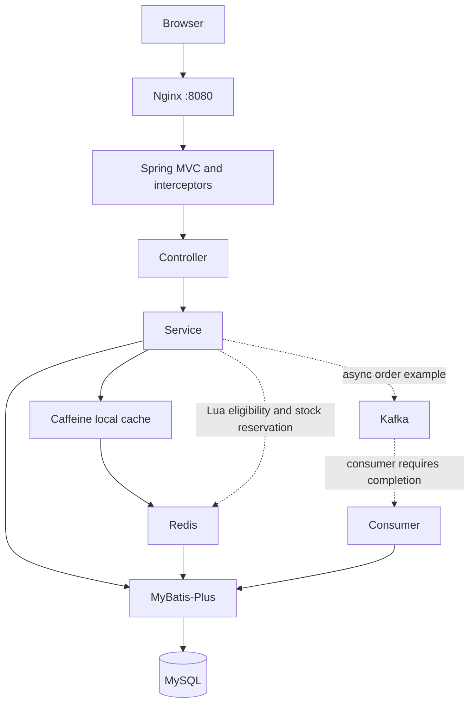

<div align="center">

# CityPerks

[中文](README.md) | **English**

### Local discovery and flash-sale vouchers

Explore merchants, caching, and asynchronous order processing through a Java backend learning project.

[](https://github.com/tommie-04/CityPerks/actions/workflows/build.yml)


[Overview](#overview) · [Technology](#technology) · [Getting started](#getting-started) · [Learning guide](#learning-guide) · [Implementation status](#implementation-status)

</div>

## Overview

CityPerks is a learning project based on the HeiMa DianPing course and accompanying extension materials. It covers merchant discovery and voucher flash sales, with examples of caching, concurrency control and rate limiting. The repository contains reference implementations and work in progress, with attribution to the original course and extension materials below.



## Technology

| Area | Tools | Entry points |
| --- | --- | --- |
| Login and sessions | Redis Hash, tokens, interceptors, ThreadLocal | `UserServiceImpl`, `RefreshTokenInterceptor`, `UserHolder` |
| Merchant cache | Empty-value caching, logical expiry, background rebuild | `ShopServiceImpl`, `CacheClient` |
| Multilevel cache | Caffeine, Redis, MySQL | `VoucherListCacheService` |
| Flash-sale eligibility | Redis String and Set, Lua | `VoucherOrderServiceImpl`, `seckill.lua` |
| Asynchronous orders | Kafka producer and consumer example | `KafkaConfig`, `SeckillVoucherConsumer` |
| Distributed locking | Redis, Lua, Redisson | `SimpleRedisLock`, `unlock.lua`, `RedissonConfig` |
| Rate limiting | Annotation, AOP, Redis sliding window | `RateLimiter`, `RateLimiterAspect`, `limiter.lua` |
| Persistence | MyBatis-Plus, MySQL | `mapper/`, `entity/`, `service/impl/` |

Voucher-list queries support `mysql`, `redis` and `caffeine` modes via `hmdp.cache.voucher-list.mode`; the default is `mysql`.

## Project layout

```text
src/main/java/com/hmdp/
├── controller/        HTTP endpoints
├── service/impl/      business logic
├── service/cache/     voucher-list multilevel cache
├── consumer/          Kafka consumer example
├── limiter/           rate-limiting annotation and aspect
├── config/            application and middleware configuration
├── mapper/           database access
├── entity/ and dto/   data models and response objects
└── utils/            caching, locks, IDs and user context
src/main/resources/    application configuration, SQL and Lua scripts
src/test/              course exercises requiring external services
frontend/              course static pages and Nginx configuration
docs/                  learning notes and improvement roadmap
```

## Getting started

Use JDK 8 or a compatible version, Maven 3.6+, MySQL, Redis and Nginx. The async order example also requires Kafka. Create a dedicated learning database: the SQL script drops and recreates tables with matching names.

```bash
mysql -u root -p -e "CREATE DATABASE IF NOT EXISTS hmdp CHARACTER SET utf8mb4;"
mysql -u root -p hmdp < src/main/resources/db/hmdp.sql
export MYSQL_USER=root
export MYSQL_PASSWORD='your-local-password'
export REDIS_HOST=127.0.0.1
export REDIS_PORT=6379
export KAFKA_BOOTSTRAP_SERVERS=127.0.0.1:9092
mvn -DskipTests package
java -jar target/hm-dianping-0.0.1-SNAPSHOT.jar
```

The backend listens on port 8081. The supplied `RedissonConfig` separately hardcodes `127.0.0.1:6379`; adjust it if your Redis requires authentication or runs elsewhere. The Kafka consumer example requires further work before end-to-end order processing.

To serve the included course frontend:

```bash
mkdir -p frontend/logs
nginx -p "$PWD/frontend/" -c conf/nginx.conf
```

Open <http://127.0.0.1:8080/>. Before testing uploads, change the course Windows path in `SystemConstants.IMAGE_UPLOAD_DIR` to the absolute path of `frontend/html/hmdp/imgs`.

## Learning guide

1. **Merchant caching:** `ShopController → ShopServiceImpl → CacheClient`.
2. **Multilevel caching:** `VoucherController → VoucherServiceImpl → VoucherListCacheService`.
3. **Flash sales:** `VoucherOrderController → VoucherOrderServiceImpl → seckill.lua → Kafka → SeckillVoucherConsumer`.
4. **Concurrency:** conditional stock updates, lock ownership, Lua unlock, transaction boundaries and idempotency.
5. **Rate limiting:** `@RateLimiter → RateLimiterAspect → limiter.lua`.

The existing [learning notes](docs/learning-guide.md) are in Chinese.

## Implementation status

The project was packaged locally and in GitHub Actions with `mvn -DskipTests package`. Integration and concurrency tests were not run.

- The Kafka listener and custom consumer factory are commented out; the producer sends a string while the consumer expects an order object. Serialization must be unified.
- Message delivery failure, transaction boundaries, uniqueness, duplicate consumption and Redis reservation compensation need further work.
- Multilevel caching and rate limiting have example implementations and require functional and load testing.
- AI support, automatic order cancellation, payment-versus-cancellation concurrency and MQ-based cache invalidation compensation are future work, not complete features in this source.

## Attribution

The base business code and frontend come from the [HeiMa Redis course](https://www.bilibili.com/video/BV1cr4y1671t) and [HeiMa DianPing starter repository](https://github.com/cs001020/hmdp). The extension reference comes from the supplied [Yuque learning document](https://www.yuque.com/kdoxioc/qp0wtr/zvp8tfp6sunsglpt) and its project attachment. Original author comments are retained. No repository-wide MIT or other license is asserted here.
