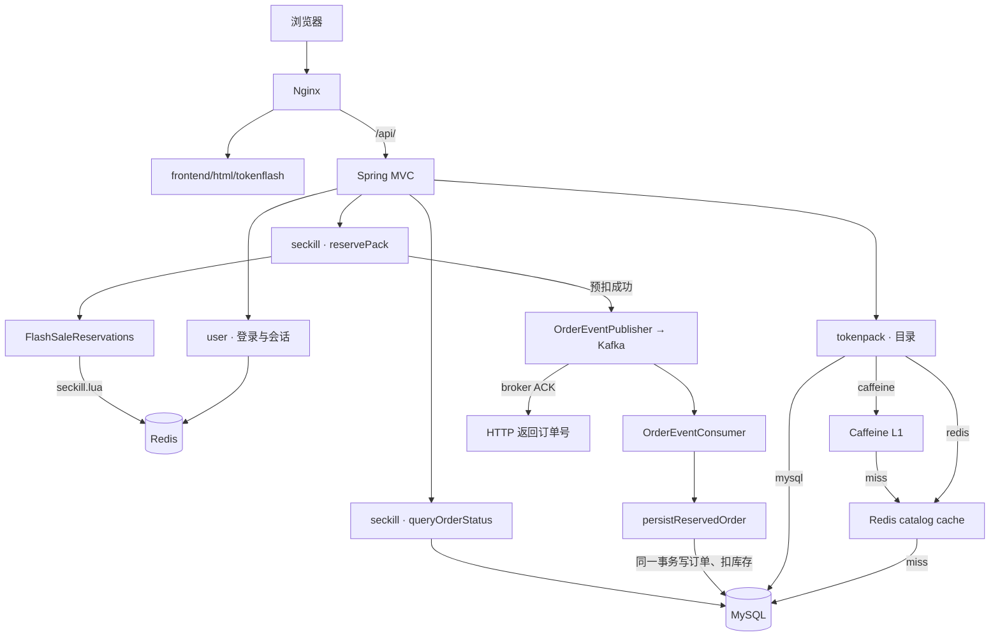

<div align="center">

# TokenFlash

[](README.md)
[](README.en.md)

**大模型 Token 包秒杀平台**

浏览文本、推理和多模态模型的额度包，参与限时秒杀并查询订单状态。

[](https://github.com/tommie-04/TokenFlash/actions/workflows/build.yml)


[系统架构](docs/architecture.md) · [快速开始](#快速开始) · [学习与面试](docs/learning-guide.md) · [React 全栈方案](docs/architecture.md#react-全栈方案)

</div>

## 业务链路

- **浏览 Token 包**。目录展示模型类型、额度、价格和活动窗口。请求走 MySQL、Redis 或 Caffeine → Redis → MySQL 三种模式之一。
- **参与秒杀**。Redis Lua 检查活动窗口、剩余包数和用户资格，并原子预扣一份。Kafka 确认接收后，接口返回订单号。
- **创建订单**。Kafka 消费者通过 MySQL 事务落单并扣减持久库存。订单主键和用户/包唯一约束支撑重复消费处理。用户能查询自己的订单是否已落库。

项目演示额度包目录和下单。真实支付、模型额度发放、订单超时关闭、失败事件补偿和客服的 Token 包工具在后续计划中。

| 模块 | 入口 |
| --- | --- |
| 目录与多级缓存 | [TokenPackController](src/main/java/com/tokenflash/tokenpack/controller/TokenPackController.java) → [TokenPackCatalogCache](src/main/java/com/tokenflash/tokenpack/service/cache/TokenPackCatalogCache.java) |
| 秒杀与订单查询 | [TokenPackOrderController](src/main/java/com/tokenflash/seckill/controller/TokenPackOrderController.java) → [TokenPackOrderServiceImpl](src/main/java/com/tokenflash/seckill/service/impl/TokenPackOrderServiceImpl.java) → [seckill.lua](src/main/resources/lua/seckill.lua) |
| 消费、重试与事务 | [OrderEventConsumer](src/main/java/com/tokenflash/infrastructure/mq/OrderEventConsumer.java) · [KafkaConfig](src/main/java/com/tokenflash/infrastructure/mq/KafkaConfig.java) |
| 登录与限流 | [MvcConfig](src/main/java/com/tokenflash/config/MvcConfig.java) · [limiter/](src/main/java/com/tokenflash/infrastructure/limiter/) |
| 课程客服参考 | [ai/](src/main/java/com/tokenflash/ai/) 使用 LangChain4j 和 Redis 会话窗口，默认关闭 |

## 架构与请求流程

TokenFlash 是按业务域组织的 Spring Boot 单体。查功能时先选业务包，再沿 Controller → Service → Mapper 阅读。Kafka 消费者运行在同一应用内，用独立的 MySQL 事务创建订单并扣库存。



## 文件目录架构

```text
TokenFlash/
├── pom.xml
├── frontend/
│   ├── conf/nginx.conf
│   └── html/tokenflash/          # 目录、登录与静态资源
├── src/main/java/com/tokenflash/
│   ├── TokenFlashApplication.java
│   ├── user/                     # 登录、用户资料与请求上下文
│   │   └── auth/ · controller/ · dto/ · entity/ · mapper/ · service/
│   ├── tokenpack/                # 目录查询、目录缓存与活动库存
│   │   └── controller/ · entity/ · mapper/ · service/{cache,impl}/
│   ├── seckill/                  # 资格判定、订单查询与落库事务
│   │   └── controller/ · entity/ · mapper/ · service/impl/
│   ├── provider/                 # 供应商资料、分类与附近查询
│   ├── community/                # 笔记、关注与图片上传
│   ├── ai/                       # 本地客服、会话仓储与工具调用
│   │   └── config/ · controller/ · entity/ · mapper/ · repository/ · service/ · tools/
│   ├── infrastructure/
│   │   ├── cache/                # 通用缓存策略
│   │   ├── redis/                # 秒杀预扣、会话、签到与索引
│   │   ├── lock/                 # 分布式锁与 Redisson 配置
│   │   ├── limiter/              # 限流注解与切面
│   │   └── mq/                   # Kafka 发布、监听与重试配置
│   ├── config/                   # MVC、MyBatis 与异常处理
│   └── common/                   # 统一返回与共享类型
├── src/main/resources/
│   ├── application.yaml
│   ├── db/                       # 基础表、增量迁移与演示数据
│   ├── mapper/TokenPackMapper.xml
│   ├── lua/                      # 预扣、限流与解锁
│   └── static/consultant.html
├── src/test/java/com/tokenflash/
├── scripts/warm-token-pack.sh
├── docs/
└── .github/workflows/build.yml
```

## 快速开始

准备 JDK 17、Maven 3.6+、MySQL、Redis、Kafka 和 Nginx。使用一个全新的本地学习库。基础 SQL 会重建其中的课程表。

```bash
mysql -u root -p -e "CREATE DATABASE tokenflash CHARACTER SET utf8mb4;"
mysql -u root -p tokenflash < src/main/resources/db/schema.sql
mysql -u root -p tokenflash < src/main/resources/db/token-packs.sql
mysql -u root -p tokenflash < src/main/resources/db/token-pack-demo.sql
```

已有学习库时，备份后只执行一次 `token-packs.sql`。如果新增唯一索引失败，先检查订单表中重复的 `(user_id, voucher_id)`。演示数据使用 101–103 号供应商和包，活动从导入起开放 30 天。

启动 MySQL、Redis 和 Kafka 后，用 Kafka 自带的 CLI 创建一个本地 topic。以下命令用单 broker 作为演示环境。

```bash
kafka-topics.sh --bootstrap-server 127.0.0.1:9092 --create --if-not-exists \
  --topic seckill-voucher-order --partitions 3 --replication-factor 1
```

启动后端。下面的环境变量用于演示登录和 Caffeine 模式。课程验证码可在本地 DEBUG 日志中查看。

```bash
export MYSQL_USER=root
export MYSQL_PASSWORD='your-local-mysql-password'
export REDIS_PASSWORD='your-local-redis-password'
export TOKEN_PACK_CACHE_MODE=caffeine
export APP_LOG_LEVEL=debug
./scripts/warm-token-pack.sh 101 102 103
mvn -DskipTests package
java -jar target/tokenflash-0.0.1-SNAPSHOT.jar
```

Redis 无密码时将 `REDIS_PASSWORD` 留空。默认应用端口 `8081`，Redis `127.0.0.1:6379` 的 DB 0，Kafka `127.0.0.1:9092`，目录缓存 `mysql`。完整变量见 [application.yaml](src/main/resources/application.yaml)。变更地址或数据库时，让预热脚本的 MySQL 和 Redis 参数与后端一致。预热脚本初始化缺失的库存键，并更新活动窗口。演示应使用独立的 Redis 库，避免复用旧版本的秒杀状态。

另开终端，在仓库根目录启动 Nginx：

```bash
mkdir -p frontend/logs
nginx -p "$PWD/frontend/" -c conf/nginx.conf
```

打开 [本地首页](http://127.0.0.1:8080/)。选包、登录、提交秒杀，再刷新订单状态。页面的库存用于展示，资格以 Redis Lua 的校验为准。

**从旧项目升级**。已有学习库可设置 `MYSQL_DATABASE=hmdp`（或原库名），后端和预热脚本共用这个值。自定义配置前缀 `hmdp.kafka`、`hmdp.ai`、`hmdp.cache.voucher-list` 分别改为 `tokenflash.kafka`、`tokenflash.ai`、`tokenflash.cache.token-pack-list`。已有表名、Redis key、Kafka 消息字段和 HTTP 路由继续兼容。

**运行测试**。按上面的步骤初始化专用测试库、Redis 和 Kafka topic 后，运行 `mvn clean verify`。订单回归测试从 HTTP 路由验证目录 Mapper、登录拦截、Lua 预扣、Kafka 消费落单和实际库存。GitHub Actions 使用隔离服务运行同一命令。

## 实现与学习边界

Kafka 按记录提交消费位点，异常默认间隔 1 秒重试 3 次，耗尽后记录错误。Redis 预扣、Kafka 发布、MySQL 落库分别跨不同系统。发布结果不明和消费重试耗尽时，保留待核对的预扣状态。后续再加入持久化失败记录、重放与补偿。课程客服保留在本地参考 profile 中，后续先做只读目录查询，再讨论用户身份、会话隔离和工具授权。

学习顺序为 **Caffeine 与 Guava → Kafka Ack、重试与幂等 → React + TypeScript 前端 → Function Calling**。[学习与面试](docs/learning-guide.md)

## 来源

基于[黑马程序员 Redis 实战课程](https://www.bilibili.com/video/BV1cr4y1671t)、[基础代码](https://github.com/cs001020/hmdp)和[扩展学习材料](https://www.yuque.com/kdoxioc/qp0wtr/zvp8tfp6sunsglpt)整理。保留课程作者署名。
