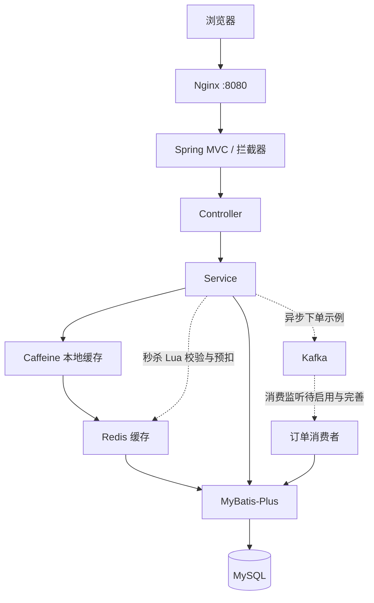

<div align="center">

# CityPerks

**中文** | [English](README.en.md)

### 雅鉴生活志 · 本地生活与优惠券秒杀

商户查询、热点缓存与异步下单，沿着真实业务链路学习 Java 后端。

[](https://github.com/tommie-04/CityPerks/actions/workflows/build.yml)


[系统概览](#系统概览) · [核心技术](#核心技术) · [快速开始](#快速开始) · [学习导航](#学习导航) · [实现状态](#实现状态)

</div>

## 系统概览

CityPerks 是基于黑马点评课程及扩展参考资料整理的学习项目。用户可以浏览商户、优惠券和探店内容，后台围绕缓存治理、秒杀资格校验、分布式锁和限流展开实现。

本仓库保存扩展参考源码及运行说明；持续完善方向包括消息可靠性、消费幂等、订单状态与并发验证。源码出处和实现状态见下文，尚未验证的功能不会作为已上线能力展示。



## 核心技术

| 模块 | 技术 | 对应代码 |
| --- | --- | --- |
| 登录与会话 | Redis Hash、Token、拦截器、ThreadLocal | `UserServiceImpl`、`RefreshTokenInterceptor`、`UserHolder` |
| 商户缓存 | 空值缓存、逻辑过期、异步重建 | `CacheClient`、`ShopServiceImpl` |
| 多级缓存 | Caffeine + Redis + MySQL | `VoucherListCacheService`、`VoucherCacheProperties` |
| 秒杀资格 | Redis String / Set、Lua 原子校验与预扣 | `VoucherOrderServiceImpl`、`seckill.lua` |
| 异步下单 | Kafka 生产者、消费者、重试示例 | `KafkaConfig`、`SeckillVoucherConsumer` |
| 分布式锁 | Redis / Lua、Redisson | `SimpleRedisLock`、`unlock.lua`、`RedissonConfig` |
| 接口限流 | 自定义注解、AOP、Redis 滑动窗口 | `RateLimiter`、`RateLimiterAspect`、`limiter.lua` |
| 数据访问 | MyBatis-Plus、MySQL | `mapper/`、`entity/`、`service/impl/` |

优惠券列表支持 `mysql`、`redis`、`caffeine` 三种查询模式，便于在相同数据和负载下进行性能对比。默认配置为 `mysql`，可在 `hmdp.cache.voucher-list.mode` 中切换。

## 项目结构

```text
CityPerks/
├── pom.xml
├── src/main/java/com/hmdp/
│   ├── controller/       # HTTP 接口
│   ├── service/impl/     # 业务实现
│   ├── service/cache/    # 优惠券多级缓存
│   ├── consumer/         # Kafka 消费示例
│   ├── limiter/          # 限流注解、AOP 与异常
│   ├── config/           # Redis、Kafka、MVC 等配置
│   ├── mapper/           # 数据访问
│   ├── entity/           # 数据实体
│   ├── dto/              # 接口传输对象
│   └── utils/            # 缓存、锁、ID 与用户上下文
├── src/main/resources/
│   ├── db/hmdp.sql       # 课程示例数据库
│   ├── mapper/           # SQL 映射
│   ├── application.yaml
│   └── *.lua
├── src/test/             # 原始课程练习，部分依赖运行中的服务
├── frontend/             # 配套课程静态页面与 Nginx 配置
└── docs/                 # 学习导航与待完善事项
```

## 快速开始

### 环境准备

- JDK 8 或兼容版本；源码与依赖基线来自 Java 8 时代课程。
- Maven 3.6+、MySQL、Redis；异步秒杀还需要 Kafka。
- Nginx 用于提供静态页面和 `/api/` 代理。

### 初始化数据库

请使用独立的学习数据库。SQL 含有删除和重建同名表的语句。

```bash
mysql -u root -p -e "CREATE DATABASE IF NOT EXISTS hmdp CHARACTER SET utf8mb4;"
mysql -u root -p hmdp < src/main/resources/db/hmdp.sql
```

### 配置并启动后端

数据库密码通过环境变量传入：

```bash
export MYSQL_USER=root
export MYSQL_PASSWORD='your-local-password'
export REDIS_HOST=127.0.0.1
export REDIS_PORT=6379
export KAFKA_BOOTSTRAP_SERVERS=127.0.0.1:9092
mvn -DskipTests package
java -jar target/hm-dianping-0.0.1-SNAPSHOT.jar
```

默认后端端口为 `8081`。`StringRedisTemplate` 读取配置文件中的 Redis 地址；原始 `RedissonConfig` 单独使用 `127.0.0.1:6379`，如需远端 Redis 或认证，需要同步修改该配置。

原始示例未配置完整的 Kafka 消费闭环。验证页面和查询接口与验证异步下单，应分开进行；具体事项见[实现状态](#实现状态)。

### 启动前端

在仓库根目录执行，要求本机已安装 Nginx：

```bash
mkdir -p frontend/logs
nginx -p "$PWD/frontend/" -c conf/nginx.conf
```

打开 <http://127.0.0.1:8080/>。静态资源来自课程配套页面，保留原有页面结构。后端上传目录在 `SystemConstants.IMAGE_UPLOAD_DIR` 中仍为课程 Windows 路径，使用图片上传前需改为本地 `frontend/html/hmdp/imgs` 的绝对路径。

## 学习导航

建议按业务问题阅读，而不是逐个文件阅读：

1. **缓存治理**：`ShopController → ShopServiceImpl → CacheClient`，理解穿透、击穿、逻辑过期与缓存失效。
2. **多级缓存**：`VoucherController → VoucherServiceImpl → VoucherListCacheService`，理解本地缓存与共享缓存的取舍。
3. **秒杀链路**：`VoucherOrderController → VoucherOrderServiceImpl → seckill.lua → Kafka → SeckillVoucherConsumer`。
4. **并发控制**：阅读条件扣库存、锁持有者校验与 Lua 解锁，再讨论事务边界和幂等约束。
5. **接口限流**：`@RateLimiter → RateLimiterAspect → limiter.lua`，对应全局、IP、用户等限流维度。

详细学习问题与后续计划见 [docs/learning-guide.md](docs/learning-guide.md)。

## 实现状态

发布前已在本地执行 `mvn -DskipTests package` 并成功打包；测试类需要外部服务，本次未执行业务集成或并发测试。CI 负责重复检查编译打包。

参考包包含完整的 Maven 源码目录，但部分扩展仍是未闭环的教学示例：

- Kafka 消费监听和自定义消费者工厂配置当前被注释；生产者发送 `voucherOrder.toString()`，消费者却按订单对象读取，需统一序列化协议。
- 需要补齐发送失败处理、数据库事务、唯一约束、重复消费与 Redis 预扣失败补偿后，才能验证完整异步下单。
- 限流和多级缓存有实现；需要在自己的环境中进行功能、并发与性能测试。
- 智能客服、订单超时关闭、支付与关单并发、缓存删除失败 MQ 补偿尚未在本源码中形成完整实现，列为后续计划。
- 未发布压测结果或生产可用性承诺；性能数字应来自可复现测试。

## 来源与说明

基础业务和静态页面来自[黑马程序员 Redis 实战课程](https://www.bilibili.com/video/BV1cr4y1671t)及[黑马点评基础代码](https://github.com/cs001020/hmdp)。扩展参考资料来自用户提供的[语雀学习文档](https://www.yuque.com/kdoxioc/qp0wtr/zvp8tfp6sunsglpt)及其 `hm-dianping.zip` 附件。

本仓库由学习者整理用于代码阅读、实践和后续改进；保留原始作者注释。原始资料未附统一的项目开源许可证，因此未额外声明 MIT 等许可证，相关内容权利归原作者所有。
