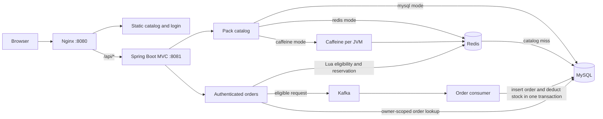
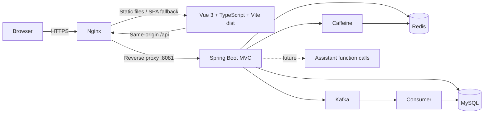

# TokenPack architecture

[中文](architecture.md) · [English](architecture.en.md) · [README](../README.en.md)

## Current system

The build uses Java 17, Spring Boot 2.7.18, MyBatis-Plus 3.5.3.1, MySQL Connector/J 8.0.33, Spring Kafka 2.8.11, Caffeine 2.9.3, and Redisson 3.17.7. LangChain4j 1.0.1 supports the local assistant reference.



| Domain concept | Current mapping |
| --- | --- |
| Model supplier | `tb_shop`, with text, reasoning, and multimodal demo entries |
| Token pack | `tb_voucher.token_units` stores the tokens per pack. Price fields use cents. |
| Stock | MySQL stores durable inventory. Redis tracks available units for reservations. |
| Order | `tb_voucher_order` enforces one order per user and pack. HTTP returns order IDs as strings. |
| HTTP entry points | `GET /token-packs/list/{providerId}`, `POST /token-pack-orders/seckill/{id}`, `GET /token-pack-orders/{id}` |
| Session | Redis Hash → `RefreshTokenInterceptor` → `UserHolder` → `LoginInterceptor` |

Legacy package names, database tables, and routes make it easier to migrate an existing learning database. The current catalog uses three demo supplier IDs. A dynamic supplier list can be added with the Vue frontend. Lua checks live stock when processing a reservation. Catalog inventory can be stale.

```text
frontend/
  conf/                     Nginx and /api proxy
  html/hmdp/                Catalog and legacy static assets
scripts/
  warm-token-pack.sh        Load sale windows and initial stock from MySQL
src/main/java/com/hmdp/
  controller/               HTTP entry points
  service/cache/            L1/L2 catalog reads
  service/impl/             Reservations, Kafka publishing, order transaction
  consumer/                 Kafka listener
  mapper/                   MyBatis-Plus data access
  config/                   Redis, Kafka, and MVC configuration
  limiter/                  Rate-limit annotations and aspect
  ai/                       Reference assistant
src/main/resources/
  db/                       Course schema, migration, demo fixtures
  mapper/                   MyBatis SQL mappings
  *.lua                     Reservation, rate-limit, and unlock scripts
docs/                       Architecture and interview notes
```

## Vue full-stack plan



```text
frontend/
  app/                      Proposed Vue 3 application
    src/
      api/                  HTTP client and domain endpoints
      routes/               Catalog, login, and order details
      stores/               Pinia session state
      features/
        catalog/            Pack cards and filters
        orders/             Reservation feedback and status polling
      components/           Shared UI
    vite.config.ts
  conf/                     Nginx serves dist and proxies /api
  html/hmdp/                Static demo during migration
src/main/                   Existing backend and migrations
```

1. Define the response types for catalog, reservation, and order status. Keep order IDs as strings and distinguish an existing order from an unknown or pending order.
2. Build the catalog, login, and order pages with Vue 3, Vite, TypeScript, Vue Router, and Pinia. Use the Composition API. Proxy `/api` during local development.
3. Serve `dist/` with Nginx, using `try_files $uri $uri/ /index.html` for browser routes and a dedicated `/api/` proxy to Spring Boot. Verify sign-in, reservation, and order lookup as a single flow.
4. Keep the backend as a Spring Boot monolith with a Kafka listener. Use cache hit ratios, consumer lag, and transaction latency to guide future scaling decisions.

The standalone Vue app, production deployment, and assistant tools are future work. [Vue Quick Start](https://vuejs.org/guide/quick-start.html)
