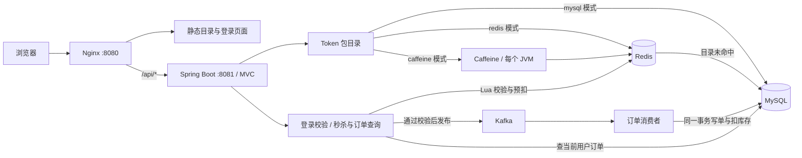
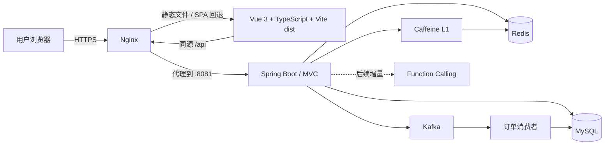

# TokenPack 架构

[中文](architecture.md) · [English](architecture.en.md) · [README](../README.md)

## 当前架构

运行基线为 Java 17、Spring Boot 2.7.18、MyBatis-Plus 3.5.3.1、MySQL Connector/J 8.0.33、Spring Kafka 2.8.11、Caffeine 2.9.3、Redisson 3.17.7。LangChain4j 1.0.1 用于本地客服参考。



| 业务概念 | 当前实现 |
| --- | --- |
| 模型供应商 | `tb_shop`，演示数据包含文本、推理、多模态三类 |
| Token 包商品 | `tb_voucher.token_units` 表示每包额度，`pay_value` 和 `actual_value` 以分计价 |
| 活动库存 | `tb_seckill_voucher.stock` 是 MySQL 持久库存，Redis 保存实时秒杀预扣库存 |
| 订单 | `tb_voucher_order`，唯一键覆盖用户 ID 和包 ID，订单号通过 JSON 字符串返回 |
| HTTP 入口 | `GET /token-packs/list/{providerId}`、`POST /token-pack-orders/seckill/{id}`、`GET /token-pack-orders/{id}` |
| 登录态 | Redis Hash → `RefreshTokenInterceptor` → `UserHolder` → `LoginInterceptor` |

沿用原有的 Java 包名、数据库表名及旧路由，降低学习库迁移成本。当前首页的供应商来自三组演示 ID。后续 Vue 目录可接入动态供应商列表。Token 包的可购买性由 Lua 在写入时判定，目录库存可能滞后。

```text
frontend/
  conf/                     Nginx 与 /api 代理
  html/hmdp/                 Token 包首页与课程静态资源
scripts/
  warm-token-pack.sh         从 MySQL 预热活动窗口和库存
src/main/java/com/hmdp/
  controller/                HTTP、鉴权后的请求入口
  service/cache/             目录 L1/L2 读取
  service/impl/              Lua 资格判定、Kafka 发布、订单事务
  consumer/                  Kafka 监听
  mapper/                    MyBatis-Plus 数据访问
  config/                    Redis、Kafka、MVC 等配置
  limiter/                   限流注解、切面和异常
  ai/                        课程客服参考代码
src/main/resources/
  db/                        课程基线、增量迁移、Token 包演示数据
  mapper/                    MyBatis SQL 映射
  *.lua                      资格校验、限流、锁释放脚本
docs/                        架构、学习路线和面试提纲
```

## Vue 全栈方案



```text
frontend/
  app/                       拟新增 Vue 3 应用
    src/
      api/                   HTTP 客户端、目录和订单接口
      routes/                目录、登录、订单详情路由
      stores/                Pinia 会话状态
      features/
        catalog/             额度包展示
        orders/              秒杀反馈、订单状态和轮询
      components/            跨页面复用组件
    vite.config.ts
  conf/                      Nginx 提供 dist、代理 /api
  html/hmdp/                 Vue 迁移期间的静态演示
src/main/                    现有 Java 服务端与迁移脚本
```

1. 先确定三条 API 的字段和错误语义。前端订单号使用 `string`，状态区分已创建与暂未查到。
2. 用 Vue 3、Vite、TypeScript、Vue Router、Pinia 实现目录、登录和订单页。新页面使用 Composition API。开发环境由 Vite 代理 `/api`。
3. 构建 `dist/` 后交给 Nginx，静态路由使用 `try_files $uri $uri/ /index.html`，`/api/` 转发到 Java 后端。用端到端测试走一遍登录、抢购和查询。
4. 保留 Spring Boot 单体与单独的 Kafka 消费线程。要扩展时先测量目录命中率、Kafka lag 和 MySQL 事务延迟，再判断是否拆分。

前端与后端保持同源，减少部署时的跨域配置。缓存与消息队列继续由后端负责。独立 Vue 工程、生产部署和客服工具均在后续阶段。[Vue 官方快速开始](https://vuejs.org/guide/quick-start.html)
