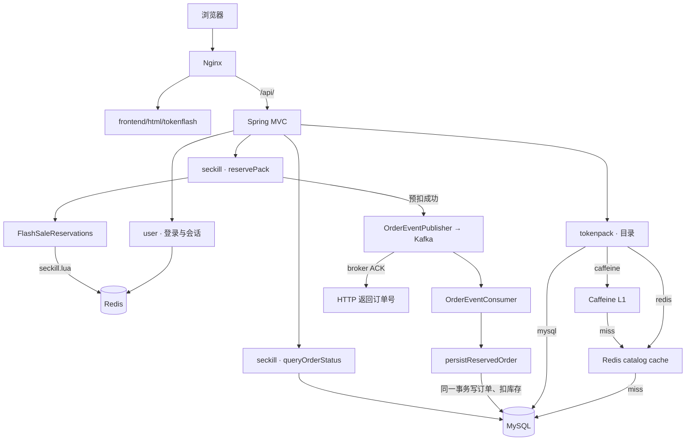
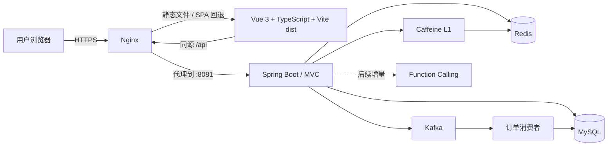

# TokenFlash 架构

[中文](architecture.md) · [English](architecture.en.md) · [README](../README.md)

## 当前架构

运行基线为 Java 17、Spring Boot 2.7.18、MyBatis-Plus 3.5.3.1、MySQL Connector/J 8.0.33、Spring Kafka 2.8.11、Caffeine 2.9.3、Redisson 3.17.7。LangChain4j 1.0.1 用于本地客服参考。

| 业务概念 | 当前实现 |
| --- | --- |
| 模型供应商 | `tb_shop`，演示数据包含文本、推理、多模态三类 |
| Token 包商品 | `tb_voucher.token_units` 表示每包额度，`pay_value` 和 `actual_value` 以分计价 |
| 活动库存 | `tb_seckill_voucher.stock` 是 MySQL 持久库存，Redis 保存实时秒杀预扣库存 |
| 订单 | `tb_voucher_order`，唯一键覆盖用户 ID 和包 ID，订单号通过 JSON 字符串返回 |
| HTTP 入口 | `GET /token-packs/list/{providerId}`、`POST /token-pack-orders/seckill/{id}`、`GET /token-pack-orders/{id}` |
| 登录态 | Redis Hash → `RefreshTokenInterceptor` → `UserHolder` → `LoginInterceptor` |

目录库存是查询时的快照；用户抢购时由 Lua 校验实时库存。

## 架构与请求流程

TokenFlash 是按业务域组织的 Spring Boot 单体。查功能时先选业务包，再沿 Controller → Service → Mapper 阅读。Kafka 消费者运行在同一应用内，用独立的 MySQL 事务创建订单并扣库存。



## 文件目录架构

```text
TokenFlash/
├── pom.xml
├── frontend/
│   ├── conf/nginx.conf
│   └── html/tokenflash/          # 目录、登录与静态资源
├── src/main/java/com/tokenflash/
│   ├── TokenFlashApplication.java
│   ├── user/                     # 登录、用户资料与请求上下文
│   │   └── auth/ · controller/ · dto/ · entity/ · mapper/ · service/
│   ├── tokenpack/                # 目录查询、目录缓存与活动库存
│   │   └── controller/ · entity/ · mapper/ · service/{cache,impl}/
│   ├── seckill/                  # 资格判定、订单查询与落库事务
│   │   └── controller/ · entity/ · mapper/ · service/impl/
│   ├── provider/                 # 供应商资料、分类与附近查询
│   ├── community/                # 笔记、关注与图片上传
│   ├── ai/                       # 本地客服、会话仓储与工具调用
│   │   └── config/ · controller/ · entity/ · mapper/ · repository/ · service/ · tools/
│   ├── infrastructure/
│   │   ├── cache/                # 通用缓存策略
│   │   ├── redis/                # 秒杀预扣、会话、签到与索引
│   │   ├── lock/                 # 分布式锁与 Redisson 配置
│   │   ├── limiter/              # 限流注解与切面
│   │   └── mq/                   # Kafka 发布、监听与重试配置
│   ├── config/                   # MVC、MyBatis 与异常处理
│   └── common/                   # 统一返回与共享类型
├── src/main/resources/
│   ├── application.yaml
│   ├── db/                       # 基础表、增量迁移与演示数据
│   ├── mapper/TokenPackMapper.xml
│   ├── lua/                      # 预扣、限流与解锁
│   └── static/consultant.html
├── src/test/java/com/tokenflash/
├── scripts/warm-token-pack.sh
├── docs/
└── .github/workflows/build.yml
```

## Vue 全栈方案



```text
frontend/
  app/                       拟新增 Vue 3 应用
    src/
      api/                   HTTP 客户端、目录和订单接口
      routes/                目录、登录、订单详情路由
      stores/                Pinia 会话状态
      features/
        catalog/             额度包展示
        orders/              秒杀反馈、订单状态和轮询
      components/            跨页面复用组件
    vite.config.ts
  conf/                      Nginx 提供 dist、代理 /api
  html/tokenflash/                 Vue 迁移期间的静态演示
src/main/                    现有 Java 服务端与迁移脚本
```

1. 先确定三条 API 的字段和错误语义。前端订单号使用 `string`，状态区分已创建与暂未查到。
2. 用 Vue 3、Vite、TypeScript、Vue Router、Pinia 实现目录、登录和订单页。新页面使用 Composition API。开发环境由 Vite 代理 `/api`。
3. 构建 `dist/` 后交给 Nginx，静态路由使用 `try_files $uri $uri/ /index.html`，`/api/` 转发到 Java 后端。用端到端测试走一遍登录、抢购和查询。
4. 保留 Spring Boot 单体与单独的 Kafka 消费线程。要扩展时先测量目录命中率、Kafka lag 和 MySQL 事务延迟，再判断是否拆分。

前端与后端保持同源，减少部署时的跨域配置。缓存与消息队列继续由后端负责。独立 Vue 工程、生产部署和客服工具均在后续阶段。[Vue 官方快速开始](https://vuejs.org/guide/quick-start.html)
